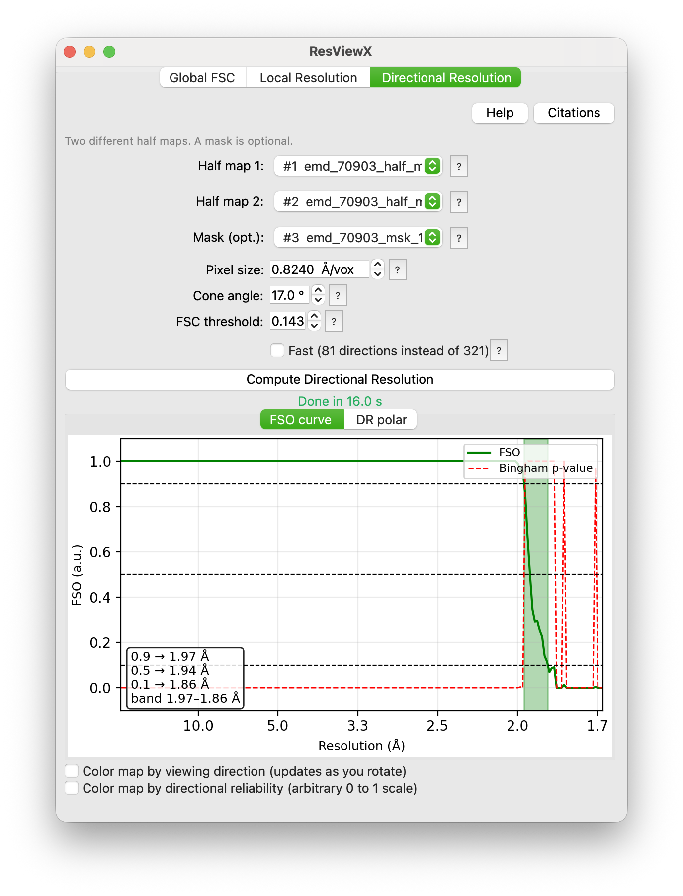
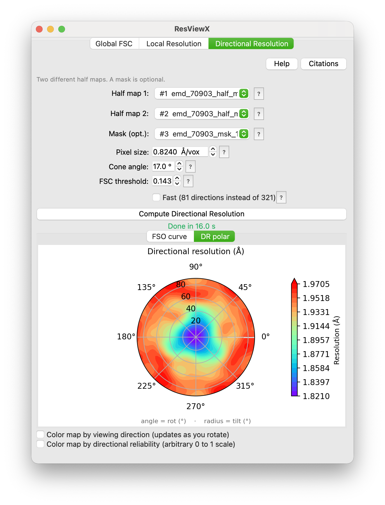
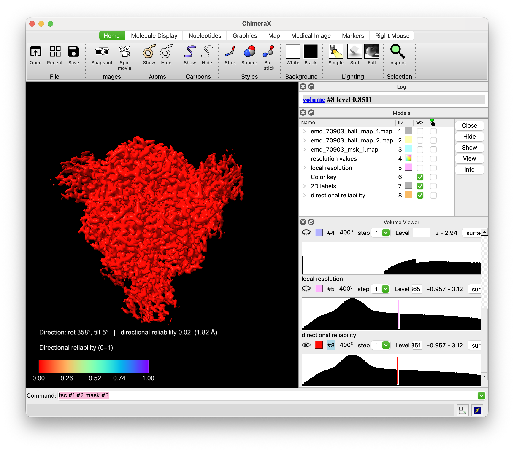

# Directional Resolution

[← Tutorial home](index.md)

A map can be sharp in one direction and blurred in another. This is called
**anisotropy**. It usually happens when particles stick to the grid in a few preferred
orientations, so some viewing directions are under-represented. A single FSC number
hides this.

**Directional resolution** measures resolution separately along many directions,
using **FSO (Fourier Shell Occupancy)** and the **Bingham test**.

## How it works, in short

ResViewX points **321 cones** in different directions, like the spines of a sea urchin,
and computes a separate FSC inside each one. Every direction gets its own resolution.
Then, at each resolution, it counts **what fraction of the directions are still
resolved**. That fraction is the **FSO curve**.

## Run it

1. Open the **Directional Resolution** tab.
2. **Half map 1** and **Half map 2:** the two half maps. Both are **required**, and
   they must be different maps.
3. **Mask (opt.):** `emd_70903_msk_1.map`. Optional, but it limits the measurement to
   the molecule.
4. **Pixel size:** filled in from the header.
5. Leave the defaults:
   - **Cone angle: 17°.** How wide each cone is.
   - **FSC threshold: 0.143.** What a direction must exceed to count as resolved.
6. **Fast (81 directions instead of 321):** about 3× faster with fewer directions.
   Fine for a quick look.
7. Click **Compute Directional Resolution**.

For this 400³ map it takes about 15–30 seconds on a recent computer, or under
10 seconds in fast mode.

The box in the lower left of the plot lists the crossings and the band, so you don't
have to read them off the curve.

## Read the FSO curve (tab "FSO curve")

- At coarse resolution, **every** direction is resolved, so the curve starts at **1**.
- Towards finer resolution, directions drop out one by one until none are left
  (**0**).
- **How wide that drop is shows the anisotropy.** The shaded band runs from where the
  curve crosses 0.9 to where it crosses 0.1:
  - **Narrow band:** all directions have about the same resolution. The map is
    **isotropic**.
  - **Wide band:** some directions are much worse than others. The map is
    **anisotropic**.

For EMD-70903 the crossings are:

| Crossing | Resolution | Meaning |
|---|---|---|
| 0.9 | 1.97 Å | Only the weakest 10% of directions have dropped out here. |
| 0.5 | 1.94 Å | Half the directions are still resolved here: the typical direction, close to the global 1.93 Å. |
| 0.1 | 1.86 Å | Only the best 10% of directions get this good. |

The band is only about 0.1 Å wide, so this map is very **isotropic**. A map with a
preferred-orientation problem could instead run from about 4.5 Å down to 2 Å.

The **Bingham test** asks, shell by shell, whether the resolved directions are spread
evenly over all orientations. A small p-value means they are not: that shell is
anisotropic. It is drawn as the red dashed line.

The results are deterministic: the same maps always give the same numbers.

## Read the polar plot (tab "DR polar")

The **DR polar** plot shows the resolution of every direction at once:

- the angle **around the circle** is the **rot** angle (which way the direction points
  horizontally);
- the **distance from the centre** is the **tilt** angle (how far it tilts from the
  top: 0° in the centre, 90° at the edge).

The colour is the resolution in that direction.

**Always check the colour bar.** It stretches to cover whatever range the map has, so
even a very isotropic map shows strong colours. Here the whole scale spans only
**1.82–1.97 Å**: the directions near the top (centre of the plot) are slightly better
than those near the edge, but the difference is only 0.15 Å. In a map with a real
preferred-orientation problem, the colour bar would span several Ångström.

## Colour the map by direction

Two options paint the map according to the direction you are looking from. **Rotate
the map, and the colour updates.**

- **Color map by viewing direction:** the whole map takes one colour, the resolution
  measured along your current line of sight, in Å.
- **Color map by directional reliability:** the same measurement, **inverted**, on an
  arbitrary 0–1 scale. Purple (1) is the most reliable view, and red (0) the least.

**Why inverted?** The detail limiting what you see on screen lies **perpendicular** to
your line of sight, not along it. So the direction with the worst measured resolution
is the view you can trust most. The 0–1 scale is deliberately not in Ångström, so it
isn't misread as a resolution.

A label in the view shows your current direction and its value, for example
`Direction: rot 358°, tilt 5° | directional reliability 0.02 (1.82 Å)`. Looking straight
down from the top, this map's best-measured direction, gives the **least** reliable
view, so the map turns red.

[← Tutorial home](index.md)
