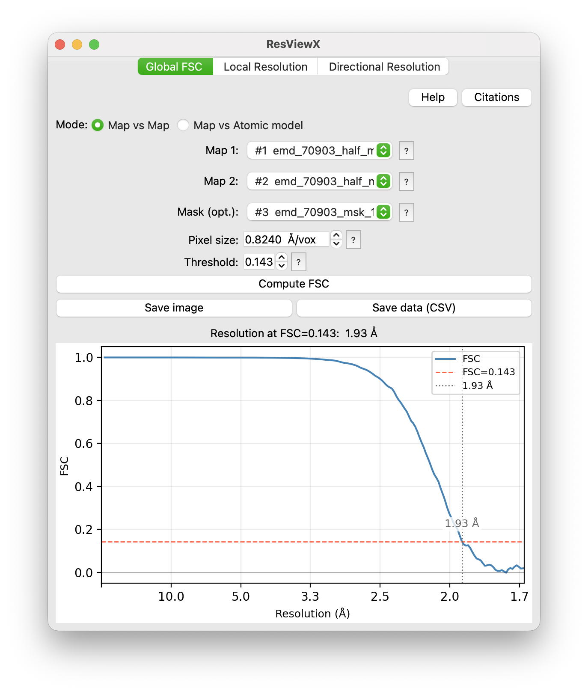

# Global FSC

[← Tutorial home](index.md)

The **Fourier Shell Correlation (FSC)** measures how well the two half maps agree, from
coarse detail to fine detail. The resolution is where that agreement drops below a
threshold. The result is **one number** for the whole map.

## Run it

1. Open the **Global FSC** tab.
2. **Mode:** choose **Map vs Map**.
3. **Map 1:** `emd_70903_half_map_1.map`.
4. **Map 2:** `emd_70903_half_map_2.map`.
5. **Mask (opt.):** `emd_70903_msk_1.map`. It is optional, but recommended.
6. **Pixel size:** filled in from the header (0.824 Å/vox).
7. **Threshold:** leave it at **0.143**, the standard value for half maps.
8. Click **Compute FSC**.

It takes a second or two. The label above the plot should read
**Resolution at FSC=0.143: 1.93 Å**, and a dotted line marks where the curve crosses
the threshold.



## Read the plot

- The **curve** is the correlation between the half maps, shell by shell. It starts
  near 1 for coarse detail on the left and falls towards 0 for fine detail on the
  right.
- The **x axis** is spatial frequency, labelled in Å: coarse detail on the left, fine
  detail on the right.
- The **resolution** is where the curve crosses the threshold line.
- **Click anywhere on the plot** to read the resolution, frequency and FSC value at
  that point.

To keep the result, use **Save image** for the plot, or **Save data (CSV)** for the
numbers.

## Try this: with and without the mask

Set **Mask (opt.)** to **None** and compute again. The resolution usually gets
**worse**, because the noisy solvent around the molecule is now included in the
comparison. That is why a mask is recommended.

## Map vs Atomic model

If you have an atomic model, **Map vs Atomic model** checks how well the map and the
model agree:

1. Open the model in ChimeraX (for example `open 1abc`).
2. **Mode:** **Map vs Atomic model**. Pick the map and the **Atomic model**.
3. **Sim. resolution:** the resolution of the map simulated from the model (with
   `molmap`). It defaults to Nyquist, twice the pixel size. For a like-for-like
   comparison, set it to your map's actual resolution.
4. The **threshold switches to 0.5**, the usual value for map-to-model comparisons.
5. Click **Compute FSC**.

## The `fsc` command

Everything in this tab is also available from the ChimeraX command line:

```
fsc #1 #2 mask #3             masked FSC (prints 1.93 Å for this example)
fsc #1 #2                     without a mask
fsc #1 #2 pixelSize 0.824     override the pixel size
fsc #1 #2 threshold 0.5       a different threshold
fsc #1 #2 plot false          print the number only, without opening the panel
fsc #1 #2 table true          also print the per-shell table to the Log
```

The command returns the resolution, so you can use it in Python scripts:

```python
from chimerax.core.commands import run
resolution = run(session, "fsc #1 #2 mask #3")
```

Next: [Local Resolution →](local-resolution.md)
