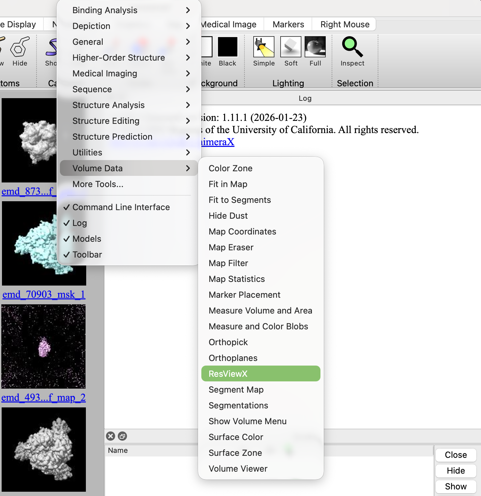

# ResViewX tutorial

**ResViewX** is a [UCSF ChimeraX](https://www.rbvi.ucsf.edu/chimerax/) plugin for
checking the resolution of cryo-EM maps inside the viewer where you inspect them. It
has three tools, each with a plot and map colouring:

| Tool | Question it answers | Method |
|---|---|---|
| [Global FSC](global-fsc.md) | What is the overall resolution of my map? | Fourier Shell Correlation |
| [Local Resolution](local-resolution.md) | Which parts of the map are better or worse resolved? | MonoRes |
| [Directional Resolution](directional-resolution.md) | Is the map equally sharp in every direction? | FSO + Bingham test |

This page covers installation and the example data. Each tool then has its own page.

---

## 1. Install

You need **ChimeraX 1.11 or newer**. Everything else (NumPy, SciPy, Matplotlib, Qt)
comes with ChimeraX.

> **Older ChimeraX versions** (for example 1.6) cannot install the plugin and stop with
> `KeyError: 'chimerax'`. Update ChimeraX to 1.11 or newer.

Download the code and install it:

```bash
git clone https://github.com/dianacord/ResViewX.git
cd ResViewX
ChimeraX --nogui --cmd "devel install . exit true"
```

If `ChimeraX` is not on your `PATH`, use the full path. On macOS:

```bash
/Applications/ChimeraX-1.11.1.app/Contents/MacOS/ChimeraX --nogui --cmd "devel install . exit true"
```

### Then restart ChimeraX

**Restart ChimeraX once** after installing. A message like
`Deferring bundle installation … ChimeraX must be restarted` is expected.

To check the install, type `usage fsc` in the ChimeraX command line. It should print
the command's options. The panel is under **Tools → Volume Data → ResViewX**.



To uninstall: `toolshed uninstall ChimeraX-ResViewX`.

---

## 2. Get the example data

The tutorial uses **[EMD-70903](https://www.ebi.ac.uk/emdb/EMD-70903)** from EMDB: two
half maps and a mask, a 400³ box at 0.824 Å per voxel. Its reported resolution is
1.93 Å.

| File | Download |
|---|---|
| Half map 1 | [emd_70903_half_map_1.map.gz](https://ftp.ebi.ac.uk/pub/databases/emdb/structures/EMD-70903/other/emd_70903_half_map_1.map.gz) |
| Half map 2 | [emd_70903_half_map_2.map.gz](https://ftp.ebi.ac.uk/pub/databases/emdb/structures/EMD-70903/other/emd_70903_half_map_2.map.gz) |
| Mask | [emd_70903_msk_1.map](https://ftp.ebi.ac.uk/pub/databases/emdb/structures/EMD-70903/masks/emd_70903_msk_1.map) |

Unzip the two half maps (double-click on macOS, or `gunzip *.gz` in a terminal), then
open all three in ChimeraX:

```
open emd_70903_half_map_1.map
open emd_70903_half_map_2.map
open emd_70903_msk_1.map
```

They are now models **#1**, **#2** and **#3**. The panel's drop-down menus list them by
name.

### What are half maps, and why a mask?

- **Half maps.** During reconstruction, the particle images are split into two
  independent halves, and each half gives its own map. Detail that appears in both is
  real signal. Detail that differs between them is noise. All three tools use this
  comparison.
- **Mask.** The mask marks where the molecule is. Without one, the empty solvent
  around the molecule adds noise and makes the resolution look worse.

---

## 3. Open the panel

Go to **Tools → Volume Data → ResViewX**. The panel has three tabs: **Global FSC**,
**Local Resolution** and **Directional Resolution**.

Every tab has:

- a **Help** button that explains the tab;
- a **Citations** button that lists the papers to cite and copies them to the
  clipboard;
- a **?** next to each input, explaining that setting.

The pixel size is read from the map header automatically. Check that it is right,
because every resolution value scales with it.

Next: [Global FSC →](global-fsc.md)

---

## Troubleshooting

| Problem | Fix |
|---|---|
| `KeyError: 'chimerax'` when installing | Your ChimeraX is too old. Update to 1.11 or newer. |
| The panel is not in the Tools menu | Restart ChimeraX after installing. |
| An old version still appears after updating | Uninstall it first (`toolshed uninstall ChimeraX-ResViewX`), reinstall, then restart. |
| "Half maps have different box sizes" | Both half maps must come from the same reconstruction, with the same box. |
| "Mask does not match the map grid" | The mask must have the same box size and pixel size as the maps. |
| Local or directional resolution is slow | It depends on map size. A 400³ map takes about 2–3 minutes for local resolution and under a minute for directional resolution on a recent laptop. The panel stays usable while it runs. |

## Citing

If you use ResViewX, please cite the plugin and the method you used. The
**Citations** button in each tab lists them.
