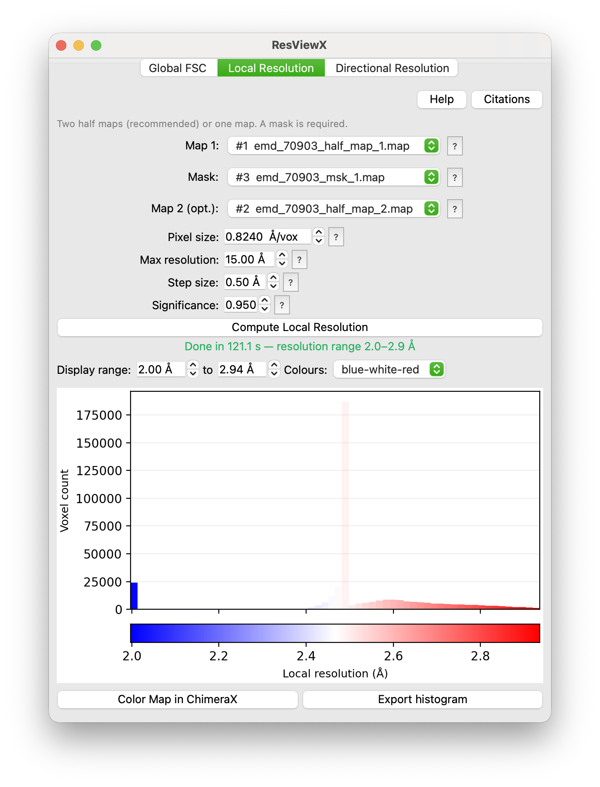
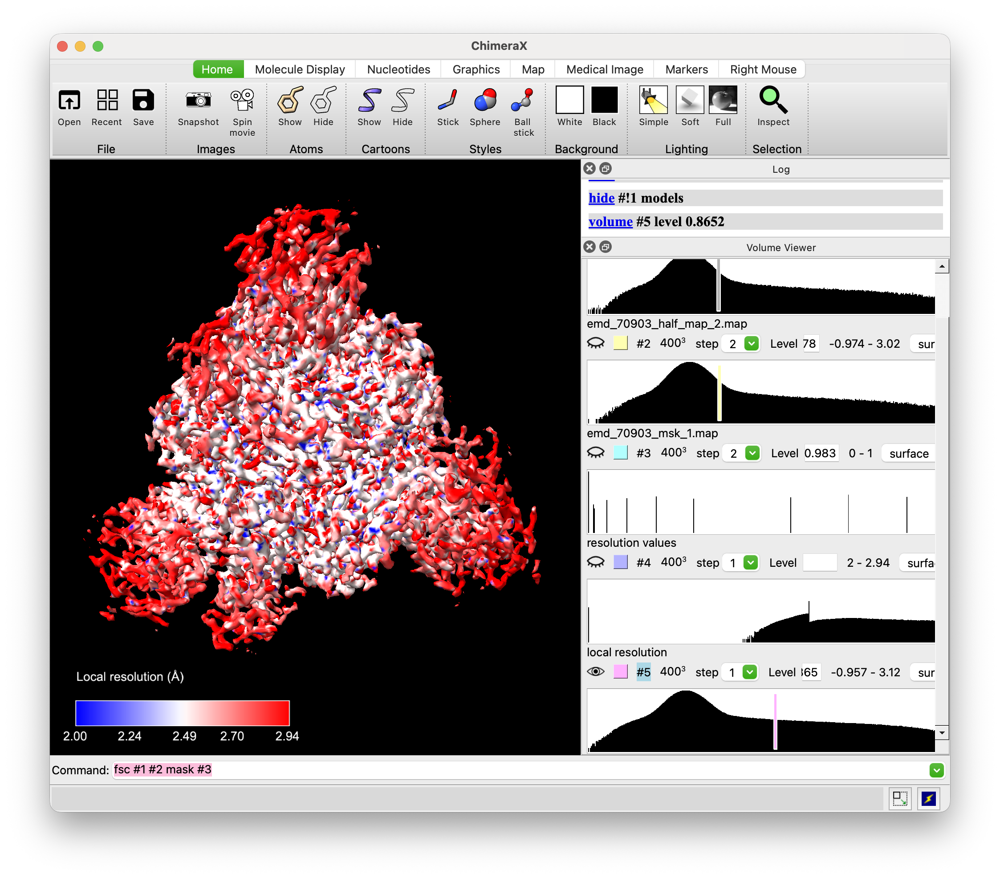

# Local Resolution

[← Tutorial home](index.md)

The global FSC gives one number for the whole map, but maps are rarely equally good
everywhere. A rigid core is usually sharper than flexible loops or the surface.
**Local resolution** estimates the resolution **at every voxel**, using **MonoRes**, so
you can see which parts of the map you can trust.

## Run it

1. Open the **Local Resolution** tab.
2. **Map 1:** `emd_70903_half_map_1.map`.
3. **Mask:** `emd_70903_msk_1.map`. **Required.**
4. **Map 2 (opt.):** `emd_70903_half_map_2.map`. Optional, but recommended (see
   below).
5. **Pixel size:** filled in from the header.
6. Leave the other settings at their defaults for a first run:
   - **Max resolution: 15 Å.** The coarse end where the search starts. It then steps
     towards finer resolution, down to Nyquist (twice the pixel size).
   - **Step size: 0.5 Å.** How finely it steps. Smaller is more precise but slower.
     The minimum is 0.25 Å.
   - **Significance: 0.95.** The confidence level of the signal-versus-noise test.
7. Click **Compute Local Resolution**.

This takes longer than the FSC: about 2–3 minutes for this 400³ map on a recent
laptop. A progress bar shows how far it is, and you can keep using ChimeraX meanwhile.
When it finishes, a green line shows the time taken and the resolution range found
(here **2.0–2.9 Å**).

## One map or two half maps?

Both work. The difference is how the noise is estimated:

- **One map + mask:** the noise is measured **outside the mask**, in the solvent.
- **Two half maps + mask:** their **average** is analysed, and the noise is their
  **difference**. Anything that differs between two independent reconstructions must
  be noise, so this estimate is more reliable.

## Read the histogram

The histogram shows how many voxels have each resolution. For this example, most
voxels sit around **2.5 Å**. That is coarser than the global 1.93 Å, which is normal:
the global FSC is dominated by the well-ordered core, while local resolution also
counts the weaker periphery.

**Display range:** set the lowest and highest resolution shown, then press **Enter**.
The histogram and the colour scale update. **Colours:** choose viridis or
blue-white-red.

## Colour the map

Click **Color Map in ChimeraX**. ResViewX colours a **copy** of the map by local
resolution, using the same colour scale as the histogram. Your original map is left
untouched.

- Typically, the **core** is the best-resolved colour and the **surface, loops and
  flexible parts** are worse.
- The colouring belongs to the structure itself, so it **does not change as you
  rotate** the map.

In this example, blue (best, about 2.0 Å) is scattered through the centre, and red
(worst, about 2.9 Å) dominates the outer parts. A colour key is added to the view, and
the coloured copy appears in the model list as **local resolution**.

To save the histogram as an image, or its values as CSV, use **Export histogram**.

Next: [Directional Resolution →](directional-resolution.md)
